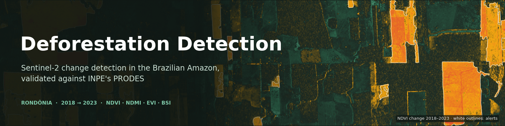
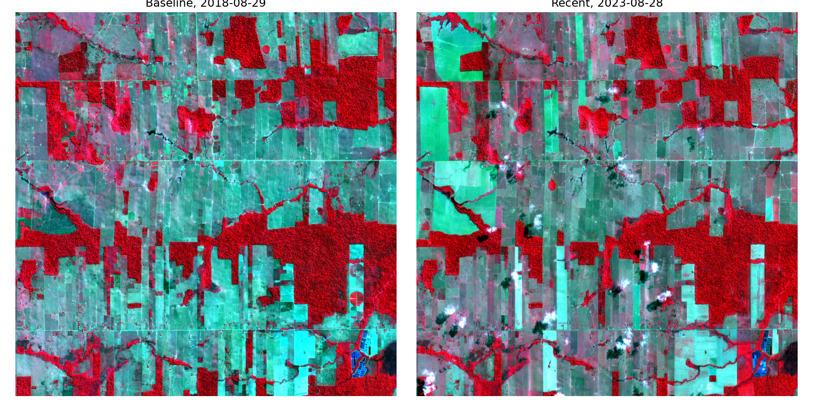
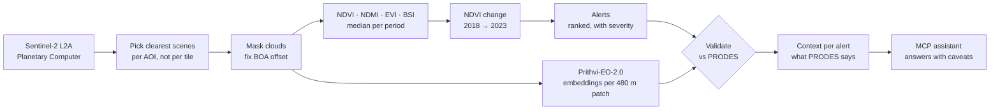
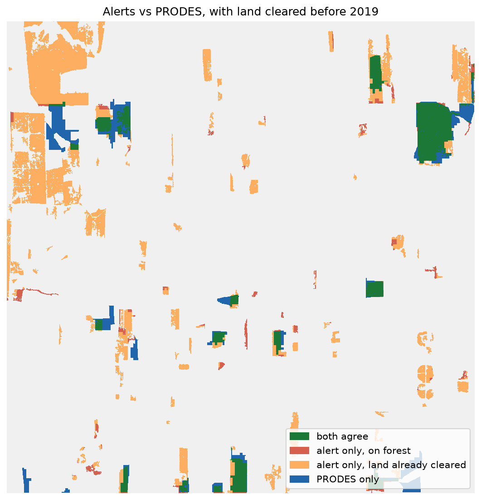
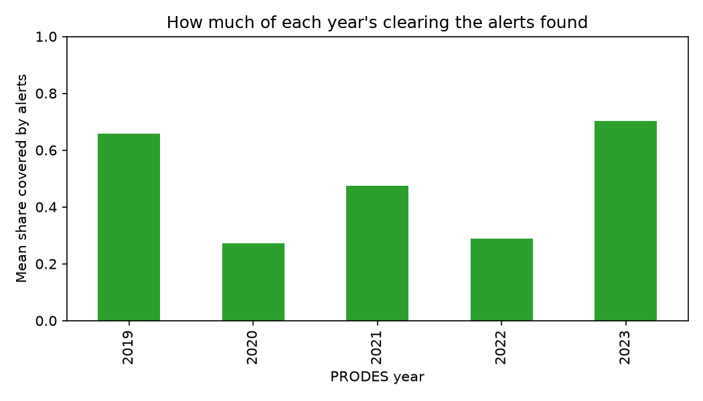
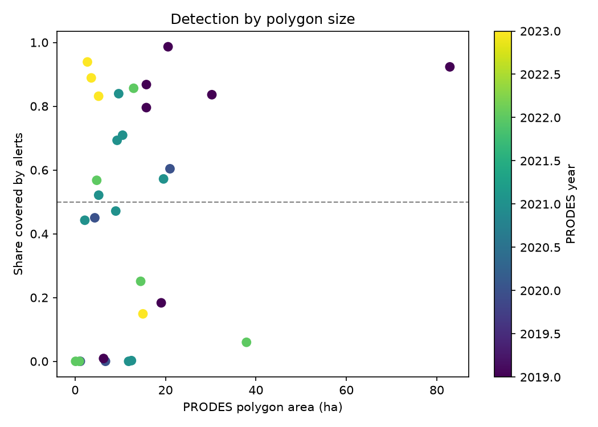
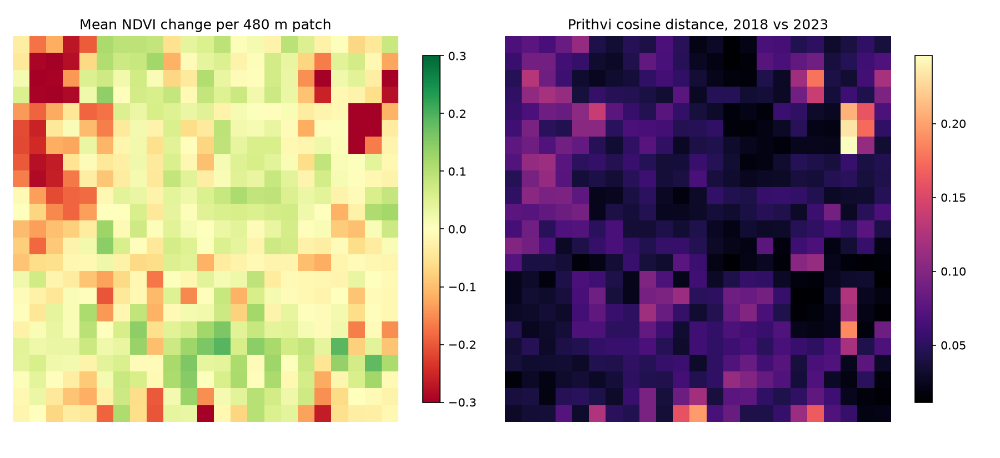

<p align="center">
  
</p>

<p align="center">
  
  
  
  
  
</p>

<p align="center">
  <b>Where did the forest go, and how far can a satellite-based answer be trusted?</b><br>
  <sub>Sentinel-2 change detection · validation against INPE PRODES · Prithvi-EO-2.0 · an MCP assistant that reports its own reliability</sub>
</p>

---

This project detects forest cover loss in the Brazilian Amazon from Sentinel-2 imagery, then checks the detections against **PRODES**, INPE's official deforestation map. The goal is to measure where the detections agree with PRODES, where they disagree, and *why*.

The study area is a 10 × 10 km window in the Rondônia deforestation arc. Two dry seasons are compared, **June–September 2018** and **June–September 2023**. The vegetation lost between them becomes a ranked list of areas to inspect.

## At a glance

<table>
  <tr>
    <td align="center"><b>81.7%</b><br><sub>of alerts on land PRODES still monitors match a mapped clearing</sub></td>
    <td align="center"><b>58.5%</b><br><sub>of PRODES 2019–2023 clearing area detected</sub></td>
    <td align="center"><b>93%</b><br><sub>of unconfirmed alerts fall on land already cleared before 2019</sub></td>
    <td align="center"><b>16 / 9 / 5</b><br><sub>PRODES clearings found / partly found / missed, of 30</sub></td>
  </tr>
</table>

<p align="center">
  <br>
  <sub><b>Same area, five years apart.</b> False colour (NIR, red, green): dense forest is deep red, pasture and bare soil are pale green or white.</sub>
</p>

## How it works



1. **Scene selection.** The pipeline searches Sentinel-2 L2A on Microsoft Planetary Computer and places the AOI well inside a single satellite swath. For each period it keeps the five clearest scenes, judged by the share of usable pixels *inside the AOI* (SCL band) rather than by tile-level cloud cover.
2. **Cleaning.** Clouds, shadows and missing data are masked. The radiometric offset that ESA introduced with processing baseline 04.00 in January 2022 is also corrected. Planetary Computer does not apply this correction, and without it the 2023 scenes look brighter than the 2018 ones, which produces a vegetation loss that isn't there.
3. **Indices and change.** NDVI, NDMI, EVI and BSI are computed per scene, then combined into a median composite per period, and the two periods are differenced.
4. **Alerts.** Pixels whose NDVI drops by more than 0.25 are turned into polygons. A polygon becomes an alert if it covers at least half a hectare, its bare-soil index rises, and it does not touch water. Alerts are ranked by area and labelled by severity, with a plain-language summary.
5. **Validation.** The alerts are compared with PRODES 2019–2023 pixel by pixel and polygon by polygon. The comparison takes into account which land PRODES no longer monitors.
6. **A second opinion.** The same composites go through Prithvi-EO-2.0, a foundation model pretrained by IBM and NASA, and the change it sees is compared with both the NDVI and PRODES.
7. **An assistant.** Every alert gets its own context (what PRODES says about the ground under it), and an MCP server lets a language model answer questions about the alerts with these numbers and caveats.

## Results

| Metric | Value |
|---|---:|
| Precision, whole AOI | 23.0% |
| Precision, where PRODES still monitors the land | **81.7%** |
| Recall | 58.5% |
| False positives on land already cleared before 2019 | 93% |
| AOI that was no longer primary forest in 2018 | 77.5% |
| Alerts | 129, covering 1,050 ha |

<p align="center">
  <br>
  <sub><b>Alerts vs PRODES.</b> Green: both agree. Blue: PRODES only. Red: alert on standing forest. Orange: alert on land PRODES stopped monitoring before 2019.</sub>
</p>

### Most of the disagreement is definitional

PRODES records only the **first clear-cut of primary forest**. Once it has recorded an area, it never maps that area again. In this AOI, 77% of the land was no longer primary forest by 2018. The alerts, by contrast, flag any strong drop in vegetation. As a result, most of what PRODES does not confirm (the orange in the map above) lies on pasture, cropland and secondary regrowth, land that PRODES no longer watches. These alerts are not *wrong*, but PRODES cannot judge them. On the land PRODES still monitors, more than four alerts out of five match a mapped clearing.

### The real limit is recall

The five clearings the alerts missed entirely have a mean NDVI change of about **−0.06**, so by 2023 their vegetation had largely grown back. Clearings that were found have a mean of −0.33. A comparison of two dates cannot see a clearing that has already recovered. With only four to nine clearings per year, there is too little data to say whether older clearings are missed more often.

<details>
<summary><b>Detection by year and by size</b></summary>
<br>
<p align="center">
  
  
</p>
</details>

## A second opinion from a foundation model

[Prithvi-EO-2.0](https://arxiv.org/abs/2412.02732) is a Vision Transformer pretrained on millions of HLS images (harmonised Landsat and Sentinel-2, 30 m). It was never trained to detect deforestation. Here it is used without any training: the six-band composites of each period are brought to the model's scale, resolution and normalisation, the whole AOI is covered with four overlapping tiles, and every 480 m patch gets one embedding per period. The cosine distance between the 2018 and 2023 embeddings is the model's measure of change.

<p align="center">
  <br>
  <sub><b>NDVI and Prithvi on the same 480 m grid.</b> Left: mean NDVI change per patch. Right: how differently the model describes each patch in 2018 and 2023.</sub>
</p>

**The model follows change in any direction.** The cosine distance has no sign. It correlates weakly with the mean NDVI change of a patch (Spearman −0.34), where losses and regrowth cancel out, and strongly with the mean *absolute* NDVI change (0.84).

**It separates the PRODES clearings at least as well as the index.** For each score, the AUC is the probability that a patch containing a PRODES clearing ranks above a patch without one (0.5 is chance).

| Score, per 480 m patch | All patches | Mostly forest in 2018 |
|---|---:|---:|
| Prithvi distance | **0.87** | **0.97** |
| Share of NDVI loss pixels | 0.87 | 0.92 |
| Share covered by alerts | 0.85 | 0.90 |
| Mean absolute NDVI change | 0.80 | 0.92 |

With 44 PRODES patches out of 529, and 23 out of 104 on land that was mostly forest, a gap of a few hundredths is within the noise. The fair reading is that a model with no rule written by hand matches the index, and may do slightly better where PRODES can still see new clearings.

**It recovers one of the two clearings that had grown back.** Of the two PRODES clearings larger than 5 ha that the alerts missed entirely, one (11 ha, 2021) sits in a patch at the 80th percentile of Prithvi distance, while its share of NDVI loss pixels (9%) is just the average of the AOI. The other (6 ha, 2020) is at the 21st percentile: the model does not see it either. Two cases are an anecdote, not a result, but they point at what an embedding can add to a two-date index.

All numbers and caveats are in [`outputs/validation_metrics.json`](outputs/validation_metrics.json) and [`outputs/prithvi_metrics.json`](outputs/prithvi_metrics.json). Run settings and the scene IDs used are in [`outputs/run_info.json`](outputs/run_info.json).

## An assistant that knows how far to trust itself

The validation says how far the alerts can be trusted as a whole. The last step brings that judgement down to each alert, and puts it in the hands of a language model that can be asked questions in plain words.

**Context for each alert** (`05_alert_context.ipynb`). For every alert, the share of its area that PRODES mapped as cleared in 2019–2023, the share already cleared before 2019, and the share that is forest PRODES still monitors. Each alert gets a land status from these shares:

| Land status | Alerts | Area | What it means |
|---|---:|---:|---|
| mapped by PRODES | 13 | 255 ha | confirmed by the official map |
| cleared before 2019 | 99 | 760 ha | on land PRODES no longer monitors: cannot be confirmed, most likely a change of land use |
| forest, not in PRODES | 17 | 36 ha | a real disagreement, worth a field check |

Summed over all alerts, these shares give back the pixel-level numbers of the validation to the decimal (242.1, 753.9 and 54.3 ha), so the two analyses agree.

They also change the reading of the ranked list: **the two largest alerts lie on land cleared before 2019.** Ranking by area alone would send a field team to a pasture first.

**An MCP server** (`mcp_server/server.py`). The [Model Context Protocol](https://modelcontextprotocol.io) lets an application such as Claude Desktop give a language model tools to call. Six tools read the files in `outputs/`:

| Tool | Answers questions like |
|---|---|
| `list_alerts` | Which are the largest alerts? Which ones are confirmed? |
| `get_alert` | Is alert 1 real deforestation? |
| `whats_here` | What is at this latitude and longitude? |
| `get_validation_summary` | How accurate are the alerts? |
| `get_foundation_model_summary` | What does the foundation model add? |
| `get_run_info` | Which images and dates were used? |

The design follows one rule: **facts and judgements are computed in code, the model only explains them.** The verdict on each alert ("confirmed", "cannot be confirmed", "disagreement") is written by deterministic code from measured numbers, and travels in the same answer as the area and the NDVI drop. Distances, percentiles and shares are computed by the tools, never left to the model.

<details>
<summary><b>An example: "Is alert 1 real deforestation?"</b></summary>
<br>

> It can't be confirmed, and it probably isn't new forest loss. The vegetation drop is real: mean NDVI fell by 0.387 and bare soil rose by 0.213. However, 98% of the alert sits on land PRODES considered deforested before 2019 and no longer monitors. Only 1.3% overlaps PRODES-mapped deforestation from 2019–2023.
>
> The most likely explanation is a change of land use on already-cleared ground, such as pasture, crops, or regrowth being cleared again, rather than loss of primary forest. Prithvi-EO-2.0 ranks the surrounding area at the 91st percentile for change. That shows how much the area changed, but it doesn't show what kind of change it was.

<sub>Claude Opus 5.5 in Claude Desktop, with the server connected.</sub>
</details>

**Evaluation** ([`evaluation/`](evaluation)). Eighteen questions were written with their expected answers, including traps: a premise that is false, a question outside the study area, a request for data that does not exist. Eight of them, chosen to cover every kind of failure, were asked in fresh chats and scored on five criteria: right tools, correct numbers, caveats present, abstaining when nothing can be said, nothing invented.

- **First round: 27 of 31 points.** Every number taken from a tool was correct. The faults came from information missing in the tools (a count of 44 areas reported where 23 applied), an ambiguous wording ("two images" for two composites of five scenes), a stale file still carrying an outdated summary, and a question outside the scope of the analysis.
- **Fixes, made in the tools rather than in the prompts:** the server now declares its scope, reports both counts, and says "composites"; the pipeline was rerun to refresh the summary.
- **Second round: all applicable points** on the questions that had failed.

The clearest illustration of why the numbers come from tools: asked twice how much forest the whole state of Rondônia has lost, a question outside the analysis, the model answered from memory with about 100,000 km² the first time and about 65,000 km² the second. Every number about the study area, by contrast, came out identical in every answer.

## Quick start

```bash
git clone https://github.com/AngelicaIseni/Deforestation-Detection.git
cd Deforestation-Detection
conda env create -f environment.yml
conda activate deforestation
jupyter lab
```

1. **`01_detection.ipynb`** needs internet access to Microsoft Planetary Computer (no account required). It writes everything to `outputs/`.
2. **Download PRODES once** from [TerraBrasilis](https://terrabrasilis.dpi.inpe.br/en/download-files/) (Legal Amazon → PRODES → vector, GeoPackage) and put it in `data/`. Check that the file name matches `PRODES_PATH` at the top of the validation notebook.
3. **`02_validation.ipynb`** reads only `outputs/` and `data/`, and downloads no imagery.
4. **`03_foundation_model.ipynb`** runs in its own environment, since PyTorch is much heavier than the rest:
   ```bash
   conda env create -f environment-gfm.yml
   conda activate deforestation-gfm
   ```
   It reads the band composites that `01_detection.ipynb` writes to `data/` and downloads the model weights (about 1.3 GB) the first time.
5. **`04_prithvi_vs_prodes.ipynb`** compares the model with the NDVI and PRODES, in the main environment.
6. **`05_alert_context.ipynb`** writes the context of each alert to `outputs/alerts_enriched.geojson`.

**The assistant.** Install [Claude Desktop](https://claude.ai/download), then in *Settings → Developer → Edit Config* add the server, with the Python of the `deforestation` environment:

```json
{
  "mcpServers": {
    "deforestation": {
      "command": "C:\\path\\to\\envs\\deforestation\\python.exe",
      "args": ["C:\\path\\to\\Deforestation-Detection\\mcp_server\\server.py"]
    }
  }
}
```

Restart Claude Desktop completely. `python mcp_server/try_server.py` calls every tool without Claude, to check the server works. The server reads `outputs/` once at start, so restart Claude Desktop after regenerating them.

You don't need to run anything to explore the results. `outputs/` is committed, and `outputs/interactive_map.html` opens in any browser.

## Repository layout

```
├── 01_detection.ipynb      scene selection → cleaning → indices → change → alerts
├── 02_validation.ipynb     comparison with PRODES
├── 03_foundation_model.ipynb   Prithvi-EO-2.0 embeddings and change map
├── 04_prithvi_vs_prodes.ipynb  the model against NDVI and PRODES
├── 05_alert_context.ipynb  what PRODES says under each alert
├── utils.py                functions shared by all notebooks
├── environment.yml         main environment
├── environment-gfm.yml     environment for the foundation model (PyTorch)
├── mcp_server/
│   ├── server.py           the assistant's tools
│   └── try_server.py       calls every tool without Claude
├── evaluation/
│   ├── questions.md        questions, expected answers, fixes
│   └── results.csv         scores of each round
├── assets/                 README images
├── outputs/
│   ├── figures/
│   ├── ndvi_change.tif                 NDVI change, Cloud Optimized GeoTIFF
│   ├── vegetation_loss.geojson         candidate polygons
│   ├── deforestation_alerts.geojson    ranked alerts
│   ├── alerts_enriched.geojson         alerts with PRODES context and land status
│   ├── interactive_map.html
│   ├── prithvi_change.tif              Prithvi cosine distance per 480 m patch
│   ├── run_info.json                   AOI, scenes, thresholds, headline numbers
│   ├── validation_metrics.json         validation results and caveats
│   └── prithvi_metrics.json            foundation model comparison
├── archive/                first version, including a Prithvi-EO-2.0 experiment
├── learning/               study notes and exercises (LEARNING.md)
└── data/                   large inputs, not tracked
```

## Limitations

- **Two snapshots.** Comparing 2018 with 2023 shows only the net difference. Land that was cleared and regrew in between is invisible, and a clearing cannot be dated.
- **Hand-picked thresholds.** The NDVI drop, the bare-soil margin and the severity cut-offs are reasonable starting points, not values calibrated on this area.
- **One small AOI.** The AOI is 10 × 10 km of a landscape that was mostly cleared before 2008. Results may differ along intact forest frontiers.
- **The reference has its own scope.** PRODES works at 30 m with a 6.25 ha minimum and maps primary forest only.
- **The foundation model sees 480 m at a time.** A patch covers about 23 ha, so a clearing is mixed with its surroundings. The model is used without fine-tuning, on Sentinel-2 L2A rather than the HLS data it was trained on.
- **A small evaluation of the assistant.** Eleven answers from one model, scored by the author. It shows where the design holds and where it failed, not how it would fare with other models or many more questions.

## Roadmap

- [x] Detection pipeline with radiometric fix and cloud masking
- [x] Validation against PRODES, at pixel and polygon level
- [x] **Foundation model.** Prithvi-EO-2.0 over the whole AOI, compared with NDVI and PRODES
- [x] **An assistant that knows how far to trust itself.** An MCP server whose tools report, for every alert, what PRODES says and how far to trust it, with an evaluation of the answers
- [ ] **Fine-tune Prithvi on PRODES** over a larger area, instead of using its embeddings zero-shot.
- [ ] A dense time series instead of two snapshots, and Sentinel-1 radar to see through clouds.

## Data and acknowledgements

- **Sentinel-2 L2A**, Copernicus programme (contains modified Copernicus Sentinel data, 2018 and 2023), accessed through [Microsoft Planetary Computer](https://planetarycomputer.microsoft.com/dataset/sentinel-2-l2a).
- **PRODES**, INPE, distributed through [TerraBrasilis](https://terrabrasilis.dpi.inpe.br/). See its [citation and licence page](https://terrabrasilis.dpi.inpe.br/en/citations-and-use-licence/) before reusing the data.

<p align="center"><sub>Made by <a href="https://github.com/AngelicaIseni">Angelica Iseni</a></sub></p>
